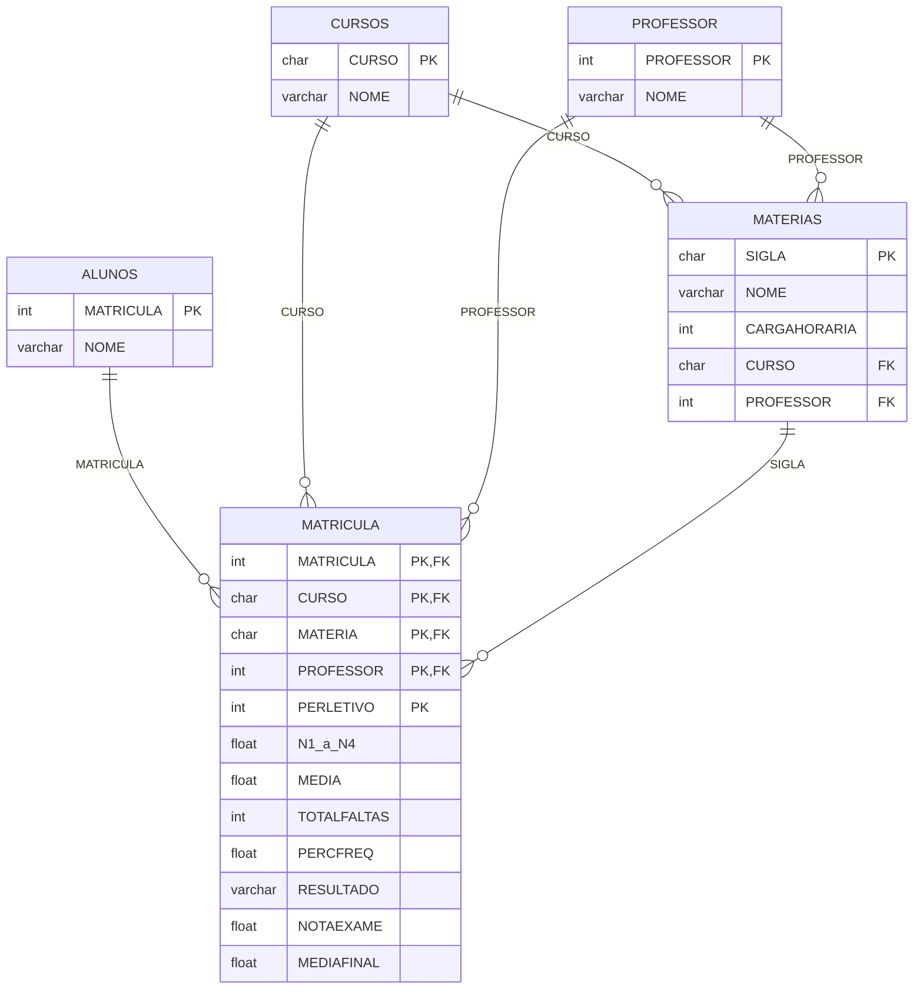

# Trabalho de Procedures: Universidade

Trabalho da disciplina de Banco de Dados II, do curso de Engenharia de Software da Univille, com o Prof. Dornel.

O projeto completa o banco `Universidade` com três stored procedures em SQL Server (T-SQL): matrícula automática do aluno nas matérias do curso, lançamento de notas com apuração do resultado no 4º bimestre e lançamento da nota de exame.

## Modelo de dados

A tabela `MATRICULA` liga cada aluno às matérias do seu curso, em um período letivo, e guarda as notas, as faltas e o resultado.

## Procedures

| Procedure | O que faz | Exemplo |
| --- | --- | --- |
| `procMATRICULAALUNO` | Cadastra o aluno e o matricula em todas as matérias do curso | `EXEC procMATRICULAALUNO 'PEDRO', 'ENG';` |
| `sp_CadastraNotas` | Lança nota e faltas do bimestre. No 4º bimestre, calcula a frequência e define o resultado | `EXEC sp_CadastraNotas 8, 'ENG', 'BDA', '2026', 7, 2, 1;` |
| `sp_LancaExame` | Lança a nota do exame e reprocessa o resultado, só para alunos em exame | `EXEC sp_LancaExame 9, 'ENG', 'BDA', '2026', 6;` |

Parâmetros da `sp_CadastraNotas`, nesta ordem: matrícula, curso, matéria, período letivo, nota, faltas e bimestre.

## Regras de negócio

| Situação | Resultado |
| --- | --- |
| Frequência abaixo de 75% | REPROVADO POR FALTA |
| Média a partir de 7 | APROVADO |
| Média de 3 até abaixo de 7 | EXAME |
| Média abaixo de 3 | REPROVADO |
| Exame com (média + nota do exame) / 2 a partir de 5 | APROVADO NO EXAME |
| Exame com (média + nota do exame) / 2 abaixo de 5 | REPROVADO NO EXAME |

Frequência = (carga horária − total de faltas) × 100 / carga horária.

## Validações

| Código | Procedure | Quando ocorre |
| --- | --- | --- |
| 50001 | `sp_CadastraNotas` | Bimestre fora do intervalo de 1 a 4 |
| 50002 | `sp_CadastraNotas` | Nota fora do intervalo de 0 a 10 |
| 50003 | `sp_LancaExame` | Aluno não está em exame |

## Como executar

1. Executar o script de criação do banco e das tabelas (Parte 01 do enunciado).
2. Executar os INSERTs de cursos, professores e matérias.
3. Criar as três procedures.
4. Executar os testes.

## Testes

Alunos matriculados em ENG, com notas em Banco de Dados (144 horas):

| Aluno | Notas | Faltas | Média | Frequência | Resultado |
| --- | --- | --- | --- | --- | --- |
| TESTE APROVADO | 7, 8, 6, 9 | 2, 4, 3, 1 | 7,5 | 93,06% | APROVADO |
| TESTE EXAME | 5, 4, 6, 5 | 2, 2, 2, 2 | 5 | 94,44% | EXAME, e com exame 6: APROVADO NO EXAME |
| TESTE FALTAS | 8, 8, 8, 8 | 10, 10, 10, 10 | 8 | 72,22% | REPROVADO POR FALTA |
